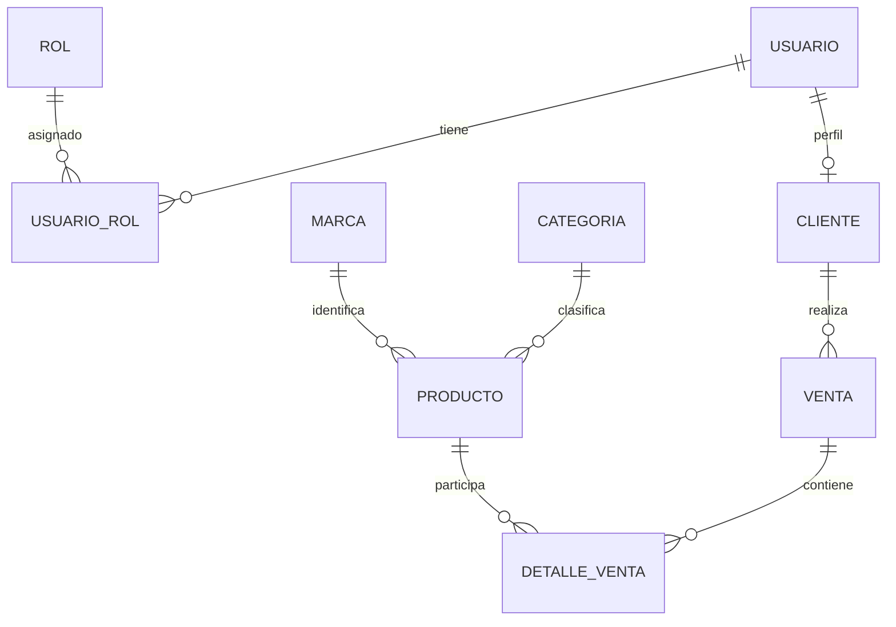

# Modelo e importación

El backend crea automáticamente las nueve tablas en techzone_v2. schema.sql es una referencia ejecutable opcional; no lo ejecutes sobre la base anterior.

Relaciones:
- usuario 1 — N usuario_rol N — 1 rol. La estructura permite varios roles, aunque la pantalla actual asigna un único rol efectivo ADMIN o CLIENTE y reemplaza la asignación anterior.
- usuario 1 — 0..1 cliente.
- categoria 1 — N producto; marca 1 — N producto.
- cliente 1 — N venta; venta 1 — N detalle_venta N — 1 producto. Es la relación muchos a muchos principal del negocio.

## Importar desde el modelo anterior de seis tablas

1. Respalda la base vieja con MySQL Workbench. Confirma que se llama techzone_db o cambia ese nombre en migrar_v1_a_v2.sql.
2. Inicia V2 una vez en techzone_v2. Detén Spring Boot. No crees productos, clientes ni ventas todavía.
3. Respalda también techzone_v2. Ambas bases deben estar en el mismo servidor MySQL.
4. Ejecuta TODO migrar_v1_a_v2.sql en Workbench, con un usuario que pueda leer ambas bases.
5. La importación conserva IDs de categorías, productos, ventas y detalles, y conserva hashes de cuentas anteriores. El admin inicial que ya exista en V2 conserva su contraseña admin123. Los productos quedan con SKU LEGACY-ID y marca Sin especificar; luego puedes editarlos en el panel.
6. El origen no guardaba precio unitario histórico: se reconstruye como subtotal/cantidad redondeado a dos decimales y se recalculan subtotales y totales. El resultado puede variar por céntimos respecto a valores antiguos con más de dos decimales. El pago se identifica como SIMULADO porque la aplicación anterior no probaba cobros reales.
7. Si hay registros inválidos o repetidos, la operación se detiene y revierte sus inserciones. El destino debe estar sin registros comerciales para evitar mezclar IDs. Si tienes datos V2 que deseas conservar, no ejecutes este importador: se necesita una migración con mapeo de IDs.
8. Reinicia V2 e inicia sesión; debes ver catálogo e historial importados. Revisa verificar.sql.

No se incluyen datos personales del servidor del usuario en este ZIP. La importación y el esquema deben comprobarse contra tu versión de MySQL antes de la entrega final.

## Diagrama de relaciones

La eliminación de un usuario, cliente, producto, categoría o marca referenciados no debe borrar compras históricas. El sistema ofrece desactivación de productos, marcas y categorías y bloquea eliminaciones incompatibles con las claves foráneas.
